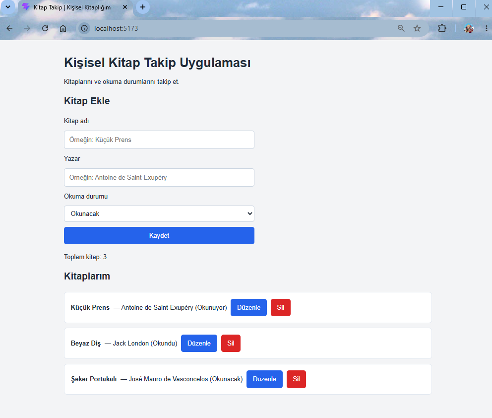

# Kitap Takip

Kitapları ve okuma durumlarını takip etmek için React ile geliştirdiğim web uygulaması.

Bu projeyi JavaScript ve React öğrenmek amacıyla geliştirdim.

## Özellikler

- Kitap adı, yazar ve okuma durumuyla yeni kitap ekleme
- Kitapları listeleme ve toplam kitap sayısını gösterme
- Kitap bilgilerini güncelleme
- Düzenleme işleminden vazgeçme
- Kitap silme
- Boş veya yalnızca boşluk içeren girişleri engelleme
- Kitapları LocalStorage ile aynı tarayıcıda saklama
- Dar ekranlara uyum sağlayan arayüz

## Kullanılan Teknolojiler

- JavaScript
- React
- Vite
- HTML
- CSS
- LocalStorage

## Kurulum ve Çalıştırma

Bilgisayarınızda Node.js ve npm kurulu olmalıdır.

Projeyi indirdikten sonra terminalde proje klasörünü açın ve bağımlılıkları yükleyin:

```bash
npm install
```

Geliştirme sunucusunu başlatın:

```bash
npm run dev
```

Terminalde gösterilen yerel adresi tarayıcınızda açın.

Sunucuyu durdurmak için terminalde `Ctrl + C` tuşlarına basın.

## Ekran Görüntüsü


